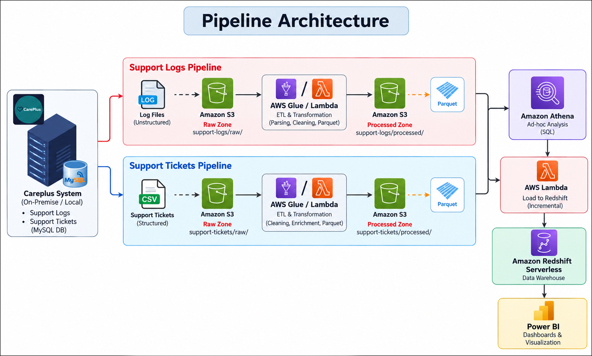
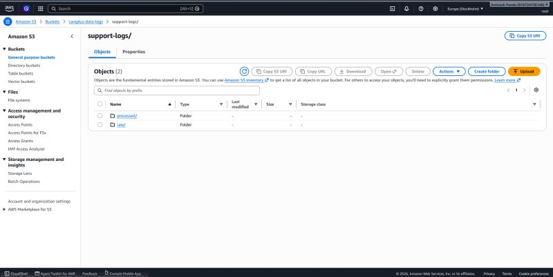
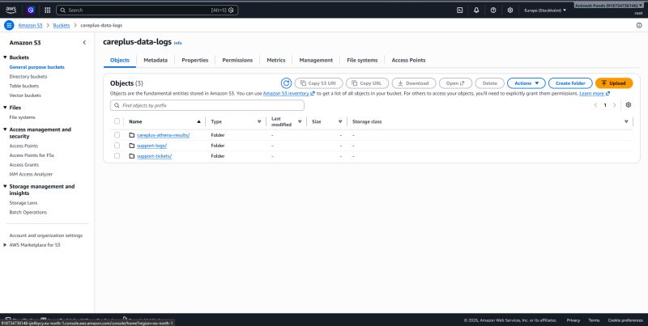
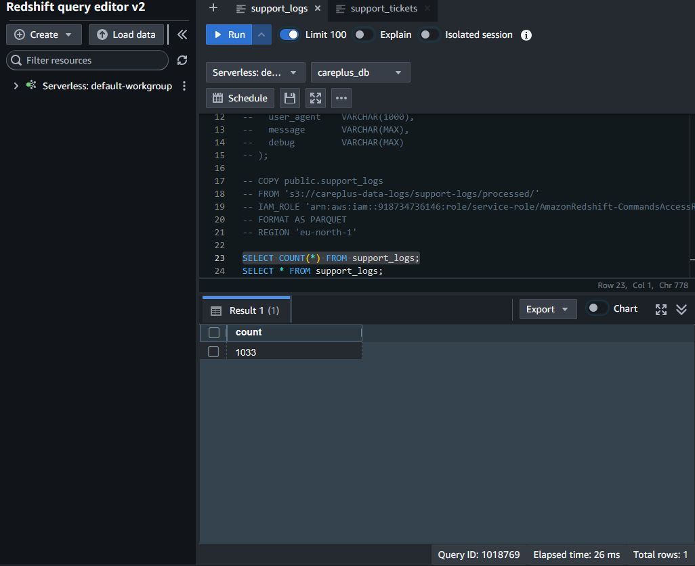
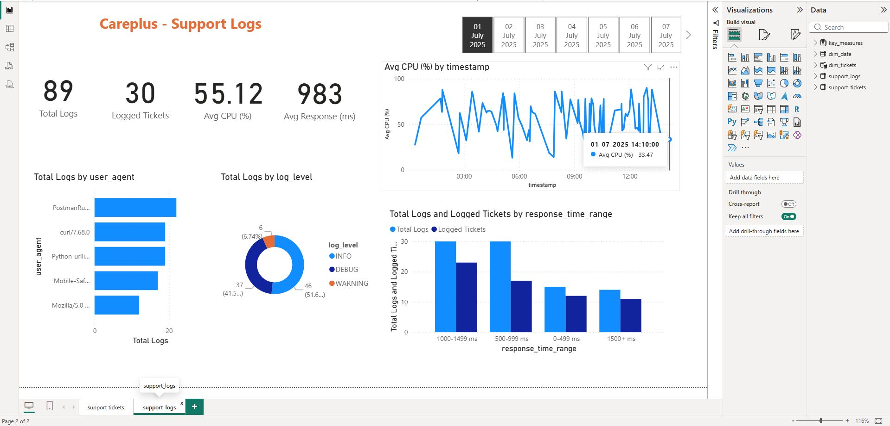
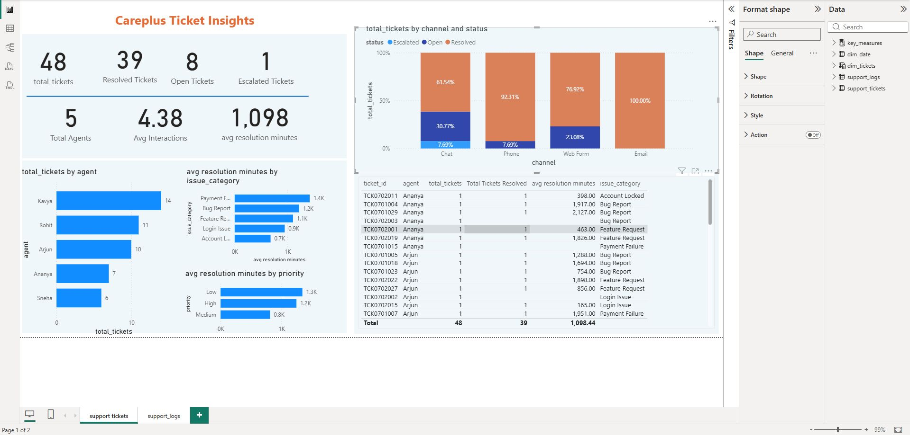

# CarePlus AWS Data Lakehouse Pipeline

> **Event-driven data engineering pipeline for ingesting, transforming, validating, and loading customer-support data into Amazon Redshift Serverless.**

[](https://www.python.org/)
[](https://aws.amazon.com/)
[](https://aws.amazon.com/s3/)
[](https://aws.amazon.com/redshift/)

## 1. Project Overview

CarePlus is a simulated SaaS support platform with two operational data sources:

- **Customer support tickets** stored in a local MySQL database
- **Unstructured application/support logs** generated as daily `.log` files

The goal of this project was to build a practical, event-driven AWS data pipeline that moves this operational data through a **Raw → Processed → Warehouse** architecture.

The pipeline performs:

**Extract → Raw S3 → Lambda ETL → Processed Parquet → Athena validation → Redshift Serverless → Power BI**

The architecture and implementation cover incremental ingestion, unstructured-log parsing, data cleansing, schema standardization, Parquet conversion, event-driven loading, Redshift `COPY`, IAM, AWS networking, Lambda dependency packaging, and BI connectivity.

---

## 2. Architecture

```text
             LOCAL / ON-PREMISE
        ┌─────────────────────────┐
        │                         │
        │  MySQL                  │
        │  support_tickets        │
        │                         │
        │  Daily application logs │
        │  *.log                  │
        │                         │
        └────────────┬────────────┘
                     │
                     │ Incremental ingestion
                     ▼
        ┌─────────────────────────┐
        │      AMAZON S3           │
        │        RAW ZONE          │
        │                          │
        │ support-tickets/raw/     │
        │ support-logs/raw/        │
        └────────────┬────────────┘
                     │
                     │ S3 ObjectCreated
                     ▼
        ┌─────────────────────────┐
        │       AWS LAMBDA         │
        │       ETL LAYER          │
        │                          │
        │ Logs: Regex + Pandas     │
        │ Tickets: Pandas +        │
        │           AWS Wrangler   │
        └────────────┬────────────┘
                     │
                     │ Write Parquet
                     ▼
        ┌─────────────────────────┐
        │      AMAZON S3           │
        │    PROCESSED ZONE        │
        │                          │
        │ support-logs/processed/  │
        │ support-tickets/         │
        │ processed/               │
        └───────┬─────────┬───────┘
                │         │
                │         │
                ▼         ▼
        ┌───────────┐  ┌────────────────┐
        │  ATHENA   │  │  AWS LAMBDA    │
        │           │  │ Redshift Load  │
        │ Validation│  └───────┬────────┘
        └───────────┘          │
                               │ COPY
                               ▼
                    ┌────────────────────┐
                    │ AMAZON REDSHIFT    │
                    │     SERVERLESS     │
                    │                    │
                    │ support_logs       │
                    │ support_tickets    │
                    └──────────┬─────────┘
                               │
                               ▼
                         ┌───────────┐
                         │ POWER BI  │
                         │ Dashboards│
                         └───────────┘
```

### Data flow

| Stage | Technology | Responsibility |
|---|---|---|
| Source | MySQL + local logs | Operational data |
| Ingestion | Python + Boto3 | Incremental extraction and S3 upload |
| Raw Zone | Amazon S3 | Durable landing area |
| Transformation | AWS Lambda | Clean, parse, standardize |
| Storage | S3 + Parquet | Processed analytical data |
| Validation | Amazon Athena | Ad-hoc schema/data checks |
| Warehouse Load | Lambda + psycopg2 | Redshift `COPY` |
| Warehouse | Redshift Serverless | Analytical SQL layer |
| BI | Power BI | Reporting and dashboards |

---

## 3. Why This Architecture?

### Amazon S3 — Data Lake

S3 acts as the central storage layer and separates the pipeline into **Raw** and **Processed** zones.

This gives the pipeline a clear boundary between:

- Data exactly as ingested
- Data that has been cleaned and standardized

### AWS Lambda — Event-Driven ETL

Lambda was used for the transformation layer because the project processes relatively small, event-driven batches.

An S3 object upload can trigger the appropriate Lambda function, allowing the pipeline to react to new data rather than relying entirely on manually executed processing.

### Parquet — Processed Storage Format

The transformation layer converts the incoming data to Parquet.

This provides a columnar format that is well suited to analytical workloads and integrates naturally with Athena and Redshift ingestion.

### Amazon Athena — Validation

Athena provides a convenient way to query the processed Parquet data directly in S3.

In this project it was used as an **ad-hoc validation/debugging layer** before loading data into Redshift.

### Amazon Redshift Serverless — Warehouse

Redshift Serverless provides the analytical warehouse layer containing the final `support_logs` and `support_tickets` tables.

### Power BI — Consumption Layer

Power BI connects to Redshift so the processed warehouse data can be consumed through dashboards and business reporting.

---

## 4. Ingestion Layer

The project contains two independent ingestion scripts.

### Support Logs

`src/ingestion/support_logs_ingestion.py`

The script:

1. Reads the last processed date from `log_date_tracker.txt`
2. Calculates the next date
3. Locates the corresponding daily `.log` file
4. Uploads it to the S3 Raw Zone
5. Updates the date tracker

Target:

```text
s3://careplus-data-logs/support-logs/raw/
```

### Support Tickets

`src/ingestion/support_tickets_ingestion.py`

The script:

1. Connects to the local MySQL database
2. Reads the next date from `date_tracker.txt`
3. Queries `support_tickets` for that date
4. Converts the result to CSV
5. Uploads the CSV to S3
6. Updates the date tracker

Target:

```text
s3://careplus-data-logs/support-tickets/raw/
```

This simulates a daily incremental ingestion process.

---

## 5. Transformation Layer

### 5.1 Support Log ETL

File:

```text
src/etl_lambda/automate_support_log_ETL.py
```

The log source is unstructured text, so the transformation requires parsing before it can be analyzed.

The Lambda function:

- Reads the raw log object from S3
- Splits individual log entries
- Uses a regular expression to extract structured fields
- Creates a Pandas DataFrame
- Removes `trace_id`
- Removes records with negative response times
- Fixes malformed log-level values
- Removes duplicate records
- Casts response time to integer
- Casts CPU utilization to float
- Converts the error field to boolean
- Converts timestamps to datetime
- Writes the result as Parquet

Example normalization:

```text
INF0    → INFO
DEBG    → DEBUG
warnING → WARNING
EROR    → ERROR
```

Output:

```text
s3://careplus-data-logs/support-logs/processed/
```

### 5.2 Support Ticket ETL

File:

```text
src/etl_lambda/automate_support_tickets_etl.py
```

The Lambda function uses AWS Wrangler and Pandas to:

- Read the raw CSV from S3
- Cast `created_at` and `resolved_at`
- Cast `num_interactions` to integer
- Drop `agent_feedback`
- Rename `IssUeCat` → `issue_category`
- Remove records with negative interaction counts
- Standardize priority values
- Select and reorder the final analytical schema
- Write the result as Parquet

Priority normalization:

```text
Lw    → Low
Medum → Medium
Hgh   → High
```

Output:

```text
s3://careplus-data-logs/support-tickets/processed/
```

---

## 6. Athena Validation

Before loading the processed data into Redshift, Athena was used to inspect the Parquet data directly in S3.

The repository contains the validation SQL in:

```text
sql/athena_queries.sql
```

Example:

```sql
CREATE EXTERNAL TABLE IF NOT EXISTS careplus_logs_parquet (
    timestamp STRING,
    log_level STRING,
    component STRING,
    ticket_id STRING,
    session_id STRING,
    ip STRING,
    response_time INT,
    cpu DOUBLE,
    event_type STRING
)
STORED AS PARQUET
LOCATION 's3://careplus-data-logs/support-logs/processed/';

SELECT *
FROM careplus_logs_parquet
LIMIT 10;
```

This was particularly useful for checking the processed schema before warehouse loading.

---

## 7. Redshift Loading

Once processed Parquet files arrive in the S3 Processed Zone, an S3 event triggers the Redshift loading Lambda.

Files:

```text
src/redshift_loader/
├── incremental_data_load_logs.py
└── incremental_data_load_tickets.py
```

The loader:

1. Receives the S3 ObjectCreated event
2. Extracts the bucket and object key
3. Builds the S3 URI
4. Opens a `psycopg2` connection to Redshift
5. Executes a `COPY` command directly from S3
6. Commits the transaction
7. Closes the database connection

Conceptually:

```sql
COPY public.support_logs
FROM 's3://.../processed/file.parquet'
IAM_ROLE '...'
FORMAT AS PARQUET
REGION 'eu-north-1';
```

The same pattern is used for `public.support_tickets`.

This avoids pulling the Parquet file into Lambda and inserting records row-by-row.

---

## 8. Redshift Schema

The warehouse contains two main tables.

### `public.support_logs`

```text
timestamp
log_level
component
ticket_id
session_id
ip
response_time
cpu
event_type
error
user_agent
message
debug
```

### `public.support_tickets`

```text
ticket_id
created_at
resolved_at
agent
priority
num_interactions
issue_category
channel
status
```

The complete DDL is available in:

```text
sql/redshift_ddl.sql
```

---

## 9. Engineering Pivot / Key Learning

One of the main engineering lessons from this project was understanding the trade-off between **AWS Glue and Lambda-based ETL**.

The project ultimately implemented the transformation layer using:

- AWS Lambda
- Pandas
- AWS Wrangler
- PyArrow

This approach worked well for the project's relatively small, event-driven batches and also required practical handling of Lambda dependency packaging.

For example, the Redshift loading function required `psycopg2`, which was packaged through a custom Lambda Layer.

### Why this matters

Lambda is useful for lightweight, event-driven workloads, but it has execution-time and resource limits.

If the pipeline grew from small daily files to very large datasets, the transformation layer would be a candidate for:

```text
S3 Event
    │
    ▼
Lambda / Orchestrator
    │
    ▼
AWS Glue / EMR + Spark
    │
    ▼
Processed Parquet
```

That would allow distributed processing instead of attempting to perform large transformations inside a single Lambda execution.

---

## 10. Challenges Solved

### Redshift Network Configuration

Redshift Serverless initially returned a `ValidationException` when network configuration changes were attempted together.

The configuration was split into separate updates, allowing the subnet configuration to settle before enabling public access.

### Power BI Connectivity

Power BI initially could not route to the Redshift endpoint.

Network/security-group configuration was adjusted to allow the required database connectivity.

> **Production note:** broad `0.0.0.0/0` database access should not be used as a permanent production configuration. Access should be restricted to trusted network ranges/VPNs.

### S3 Event Trigger Region Mismatch

The S3 bucket and Lambda function were initially deployed in different AWS regions.

The Lambda function was redeployed in the S3 bucket's region so the S3 event integration could be configured correctly.

### Lambda Timeout

The Redshift loader initially timed out because the Lambda timeout was only 3 seconds.

It was increased to 1 minute to allow enough time for the remote Redshift connection and `COPY` operation.

### Missing `psycopg2` Dependency

`psycopg2` was not available in the Lambda runtime by default.

A custom Lambda Layer containing the required compiled dependency was attached to the function.

---

## 11. Visual Evidence

The `assets/` directory is intended for screenshots demonstrating successful pipeline execution.

Recommended evidence:

### S3 Processed Data

```text
assets/s3_processed_logs.png
```

Show the processed Parquet object(s) in the S3 Processed Zone.

### Redshift Load Verification

```text
assets/redshift_row_count.png
```

Show the resulting Redshift row count/query output.

These screenshots make the repository more useful to a reviewer because they provide visible evidence that the pipeline was actually executed.

---

## 12. Visual Evidence

### Pipeline Architecture



### S3 Data Lake

The screenshots below show the S3 bucket and the Raw/Processed zone structure produced by the pipeline.





### Redshift Load Verification

The Redshift query output below provides a direct warehouse validation of the loaded support-log records.



### Power BI Output

The final analytical layer is exposed through Power BI dashboards for both support logs and support tickets.





## 13. Repository Structure

```text
aws-data-lakehouse-pipeline/
│
├── .gitignore
├── .env.example
├── README.md
├── requirements.txt
│
├── assets/
│   ├── pipeline_architecture.png
│   ├── s3_bucket_overview.jpg
│   ├── s3_raw_processed_zones.jpg
│   ├── redshift_row_count.jpg
│   ├── support_logs_dashboard.jpg
│   └── support_tickets_dashboard.jpg
│
├── src/
│   ├── ingestion/
│   │   ├── support_logs_ingestion.py
│   │   └── support_tickets_ingestion.py
│   │
│   ├── etl_lambda/
│   │   ├── automate_support_log_ETL.py
│   │   └── automate_support_tickets_etl.py
│   │
│   └── redshift_loader/
│       ├── incremental_data_load_logs.py
│       └── incremental_data_load_tickets.py
│
└── sql/
    ├── redshift_ddl.sql
    └── athena_queries.sql
```

---

## 14. Installation & Local Setup

### Prerequisites

Install:

- Python 3.x
- MySQL
- An AWS account
- AWS S3 access
- Amazon Redshift Serverless
- Amazon Athena
- Power BI Desktop (for the dashboard layer)

### Clone the repository

```bash
git clone <YOUR_GITHUB_REPOSITORY_URL>
cd aws-data-lakehouse-pipeline
```

### Create a virtual environment

Windows:

```bash
python -m venv .venv
.venv\Scripts\activate
```

Linux/macOS:

```bash
python3 -m venv .venv
source .venv/bin/activate
```

### Install dependencies

```bash
pip install -r requirements.txt
```

### Configure environment variables

Create:

```text
.env
```

using:

```text
.env.example
```

as the template.

Configure your AWS, MySQL, and Redshift credentials locally.

**Never commit `.env` to GitHub.**

---

## 14. Running the Ingestion Layer

### Logs

```bash
python src/ingestion/support_logs_ingestion.py
```

### Support tickets

```bash
python src/ingestion/support_tickets_ingestion.py
```

The ingestion scripts expect the local source files/database and date-tracker files to exist.

---

## 15. AWS Lambda Deployment

The Lambda functions in `src/etl_lambda/` and `src/redshift_loader/` are designed around S3 event notifications.

Depending on the deployment method, dependencies such as:

- `pandas`
- `pyarrow`
- `awswrangler`
- `psycopg2`

may need to be provided through Lambda-compatible deployment packages or Layers.

The repository contains the application code; AWS-specific deployment configuration is intentionally kept outside the source tree.

---

## 16. Security

This repository deliberately excludes sensitive configuration.

### Never commit

```text
.env
AWS access keys
AWS secret keys
Database passwords
Local CSV files
Local log files
Generated Parquet files
```

The `.gitignore` protects common local secrets and generated data.

Use environment variables for credentials and configuration.

For production, use a managed secret/configuration service and least-privilege IAM policies rather than long-lived credentials in local configuration.

---

## 17. What This Project Demonstrates

This project goes beyond simply moving a CSV from one service to another. It demonstrates an end-to-end data engineering workflow:

- **Incremental ingestion**
- **S3 Raw/Processed data zones**
- **Event-driven architecture**
- **Unstructured log parsing with regex**
- **Pandas-based transformation**
- **AWS Wrangler**
- **Parquet conversion**
- **Data quality cleaning**
- **Schema standardization**
- **Athena validation**
- **Redshift Serverless**
- **Redshift `COPY` from S3**
- **IAM-based access**
- **Lambda dependency packaging**
- **AWS networking/debugging**
- **Power BI integration**
- **Cloud-to-warehouse data movement**

---

## 18. Future Improvements

If this were extended toward a production-grade implementation, the next improvements would include:

- Replace local text-file date trackers with a durable metadata/state store
- Add structured logging and centralized monitoring
- Add automated data-quality tests
- Add retry and failure handling
- Add a dead-letter/error path for failed events
- Use AWS Secrets Manager or another managed secret store
- Restrict network access to trusted CIDRs/VPNs
- Add infrastructure-as-code with Terraform or AWS CDK
- Add CI/CD for Lambda deployments
- Add automated tests for ingestion and transformation logic
- Migrate large-scale transformation workloads to Glue/EMR + Spark when required

---

## 19. Project Summary

**CarePlus Data Lakehouse** demonstrates how operational data from MySQL and unstructured application logs can be transformed into an analytical data platform using AWS.

The final pipeline is:

```text
MySQL + Logs
     ↓
S3 Raw
     ↓
Lambda ETL
     ↓
S3 Processed / Parquet
     ↓
Athena Validation
     ↓
Lambda + Redshift COPY
     ↓
Redshift Serverless
     ↓
Power BI
```

The project focuses on the engineering decisions and practical AWS problems encountered while building that flow — particularly event-driven processing, schema transformation, Parquet-based storage, Redshift loading, Lambda limitations, dependency packaging, and cloud networking.
